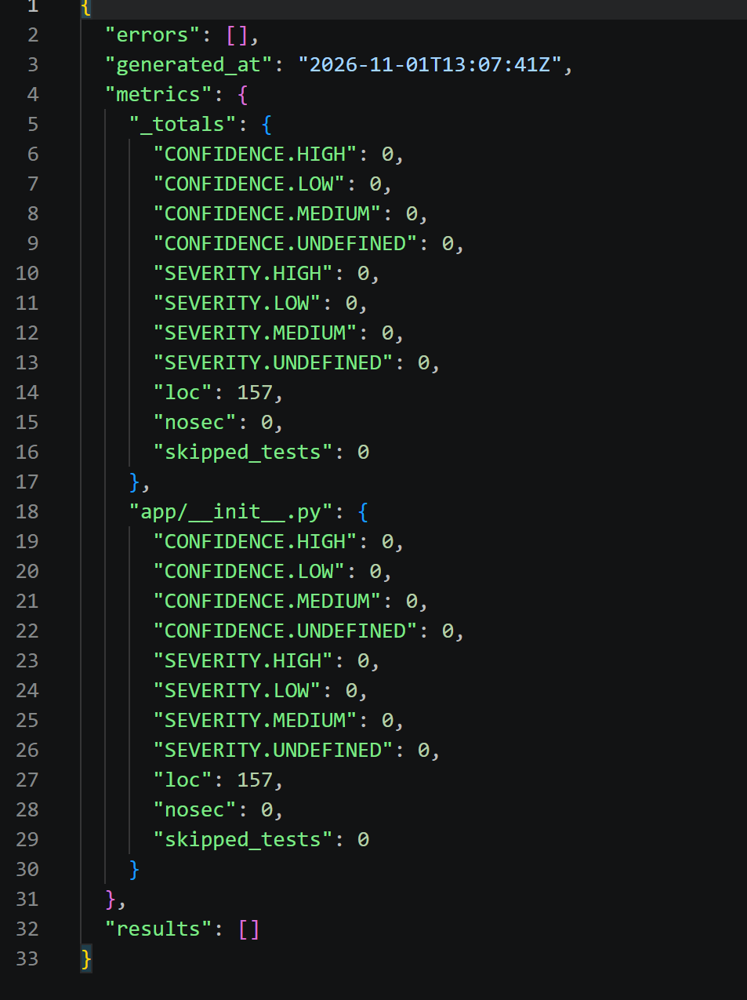
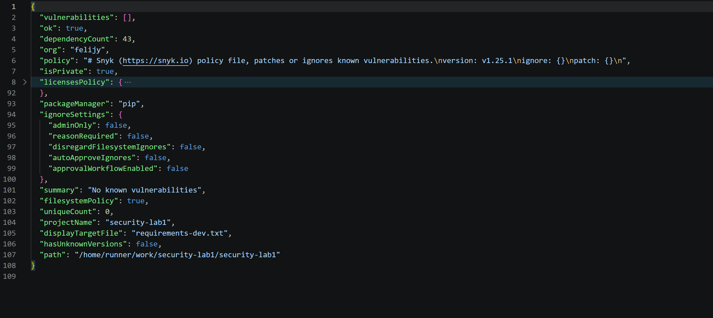
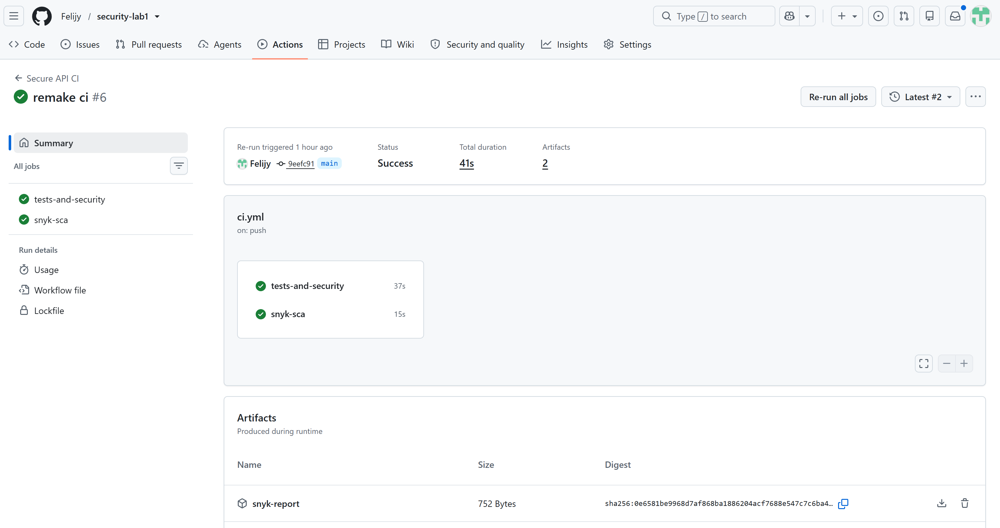

# Описание работы

Сервис для личных заметок на Python 3.12, Flask и SQLite.
Пользователь входит по логину и паролю, получает JWT и работает со своими заметками.

## API

| Метод | Эндпоинт | Тело запроса | Ответ |
|---|---|---|---|
| POST | `/auth/login` | `{"username":"USERNAME","password":"PASSWORD"}` | Токен в `access_token` |
| GET | `/api/data` |  | Заметки в `data` |
| POST | `/api/notes` | `{"title":"Note","content":"Hello"}` | Созданная заметка |

Для `/api/data` и `/api/notes` необходим заголовок `Authorization: Bearer <JWT>`.
Отсутствующий, неверный или просроченный токен возвращает `401`.

## Меры защиты

- **SQLi:** все пользовательские значения передаются в SQLite отдельными
  параметрами `?`, например `WHERE username = ?`. Пользовательский ввод
  не подставляется в текст SQL-запроса.
- **XSS:** `markupsafe.escape()` экранирует заголовок и содержимое заметки
  при создании и чтении. Символы `<`, `>`, `&` и кавычки возвращаются в безопасном
  виде. Исходный текст хранится в БД, поэтому двойного экранирования нет.
- **Пароли:** Werkzeug создаёт scrypt-хэш с индивидуальной случайной солью;
  пароль проверяется через `check_password_hash()`. Открытые пароли не хранятся.
  Ответ при неверном пароле и неизвестном пользователе одинаковый.
- **JWT:** после входа выдаётся токен на 15 минут. Декоратор `protected`
  проверяет подпись, срок действия, обязательные claims, издателя, аудиторию
  и существование пользователя на обоих защищённых эндпоинтах.
- **Контроль доступа:** владелец заметки определяется по токену; чтение фильтруется
  по `owner_id`. Чужие заметки недоступны.

## Проверки CI

При каждом `push` и `pull_request` GitHub Actions запускает автотесты,
**Bandit (SAST)**, **Snyk Open Source (SCA)** и дополнительный аудит **pip-audit**.
Находки уязвимостей и ошибки проверок останавливают pipeline.
Отчёты доступны в Artifacts: `tests-and-security` и `snyk-report`.

## Скриншоты отчётов SAST/SCA

**SAST: Bandit**

**SCA: Snyk**

**Успешный pipeline**

